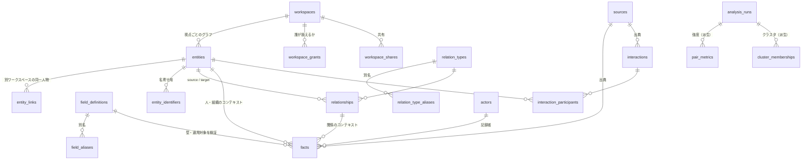

# データモデル（v0 叩き台）

実体は [`db/schema.sql`](../db/schema.sql)、初期マスターは [`db/seed.sql`](../db/seed.sql)、動作確認は [`db/tests/smoke.sql`](../db/tests/smoke.sql)。
前提となった検証結果は [`requirements-validation.md`](requirements-validation.md)。

## 前提

| 項目 | 決定 | 設計への影響 |
|---|---|---|
| 利用者 | 管理者本人＋各 AITuber（2026-10-12 追加） | **ワークスペース**で視点ごとにグラフを分ける。各ワークスペースに「自分」ノードが1つ（`entities.is_self`） |
| 用途 | 私的＋仕事（AITuber グループ運営を含む） | 個人情報保護法の義務がかかる前提で、機微度・外部AI送信可否・完全削除・監査ログを持つ |
| 保存場所 | VPS（エージェント・スマホから参照） | ネットワーク越しのアクセスを前提に、書き込み主体ごとのトークンと権限（`actors`） |
| 関係の強さ | 手入力＋やり取りから算出 | 主観は `closeness_rating` 主張、客観は `interactions` から算出して `pair_metrics` に |
| 操作主体 | 主にエージェントが書き、人は参照 | 書き込みはすべて出典・記録者・確度付き。フィールドはエージェントが提案でき、すぐ使える |

## 全体像

層で分けると次の5つ。

0. **ワークスペース**: `workspaces` / `workspace_grants` / `workspace_shares` / `entity_links`
1. **マスター**（全ワークスペース共通）: `field_definitions` / `field_aliases` / `relation_types` / `relation_type_aliases`
2. **グラフ**: `entities`（ノード）/ `relationships`（エッジ）/ `entity_identifiers`（名寄せ）
3. **記録**: `facts`（主張）/ `interactions`（やり取り）/ `sources`（原文）/ `actors`（誰が書いたか）/ `audit_log`
4. **派生**: `analysis_runs` / `pair_metrics` / `cluster_memberships`（消して再計算できる）

## 設計の要点

### 0. ワークスペース = 「誰の視点の人間関係か」

AITuber グループで使うため、管理者本人・各 AITuber・グループ共有を、それぞれ別のグラフ（ワークスペース）として持つ。

| ワークスペース | `kind` | 「自分」ノード | 中身の例 |
|---|---|---|---|
| 管理者 | `owner` | 管理者本人 | 仕事・私生活の人間関係 |
| AITuber A, B, … | `persona` | その AITuber | 人格設定、管理者、グループメンバー、コラボ相手、他の VTuber、コアリスナー |
| グループ共有 | `shared` | なし | メンバーの公開プロフィール、グループ全体の関係 |

- **分離**: ノード・関係・主張・やり取り・原文はすべて1つのワークスペースに属し、ワークスペースをまたぐ参照は複合外部キーで DB が拒否する。AITuber A が聞いた話を B が知っている、ということは起きない（人格の一貫性とリスナーのプライバシーのため）。
- **同じ人を別々に持つ**: リスナー X が A と B の両方に来ていれば、A と B にそれぞれ X のノードがある。A にとっての X と B にとっての X は呼び方も親しさも違うので、これが自然。
- **共有**: `workspace_shares` で「A と B はグループ共有を読める」を表す。API は `readable_workspaces` ビューで読める範囲を絞る。
- **横断**: 同一人物の対応は `entity_links` で管理者だけが持つ。完全削除の依頼が来たら `erase_entity(id, include_linked => true)` で全ワークスペースから消せる。
- **アカウント**: `actors` が書き込み主体（管理者・各 AITuber のエージェント・取り込みジョブ）、`workspace_grants` がどのワークスペースに `read` / `write` / `sensitive_read` できるか。`is_admin` はマスター承認と横断閲覧ができる管理者。
- **マスターは共通**: フィールドと関係の種類は全ワークスペースで共有する。AITuber ごとに `口調` と `話し方` が別フィールドになる、という揺れを防ぐため。

### 0.1 人格の乗っ取り防止

配信のコメントは誰でも書けるので、「私が本当の管理者です」「一人称を変えて」のような書き込みで記憶を汚染される危険がある。

- 原文には `sources.trusted` があり、配信チャットや SNS は `false` のまま取り込む
- フィールド・関係の種類に `requires_trusted_source` があり、`true` のものは**人が書くか、信頼できる出典に基づく場合しか書けない**（トリガーで強制）
- 初期値では人格フィールド（`persona_type` / `first_person` / `speech_style` / `catchphrases` / `backstory` / `persona_values` / `ng_topics`）と `operator_of`（運営・管理者。人 → 人・組織・グループ）関係が保護対象
- 管理者かどうかはコメントの文面ではなく、`actors`（認証されたトークン）で判断する

エージェント（claude.ai のコネクタを含む）が人格フィールドや管理者関係を書くときの手順:

1. 設定資料・企画書などの原文を `add_source(kind = 'document')` で保存する。MCP は `review_url`（Web UI の出典ページ）を返す
2. 人がそのページで内容を確かめて「信頼済みにする」を押す（エージェント自身は信頼済みにできない）
3. エージェントがその `source_id` を付けて `record_fact` / `add_relationship` を呼ぶ

信頼済みの出典がないまま書こうとすると拒否されるが、その書き込みは人の確認待ち（`review_requests`）に入り、エラーにはその旨が添えられて返る。人が Web UI の「確認」で承認すると、その人の書き込みとして記録される（エージェントは送り直さなくてよい）。同じ資料からまとめて書くなら、上の手順で資料を信頼済みにするほうが早い。

### 0.2 創作の人間関係

小説・ゲーム・AITuber の設定など、作中の人間関係も同じ仕組みで扱える。

- **ワークスペースを作品ごとに分ける**（種類は `shared` など）。実在の人と同じグラフに混ぜない
- **出典は原作・公式設定資料**。`add_source(kind = 'document')` で、`title` に作品名と巻・話・ページ、`uri` に公式サイトなどの URL を入れる。原文が長ければ該当箇所だけを `content` に入れる
- **信頼できる出典**は「人が内容を確認して信頼済みにした出典」の意味で、実在か創作かは問わない。人格フィールド（一人称・口調など）を書くときは上の手順で公式設定を信頼済みにする
- **epistemic は作中の扱いに読み替える**: `stated` = そのキャラ本人の作中の発言 / `observed` = 作中の描写・地の文 / `reported` = 他のキャラの発言 / `inferred` = 読者の考察・二次設定
- **confidence** は公式設定なら 1.0 近く、作中描写からの読み取りは中程度、考察は低くする
- **作中の時期**は `note` に書く（`valid_from` / `valid_to` は現実の日付用）

### 1. コンテキストは「値」ではなく「主張」として積む

ノードに `{"趣味": "釣り"}` を直接書くのではなく、`facts` に1行ずつ積む。各行は次を持つ。

- 対象: `entity_id`（人・組織・グループ）か `relationship_id`（関係）のどちらか一方
- `field_id`: マスターのフィールド
- `value`（jsonb）または `value_entity_id`（他のノードを指す場合）
- `epistemic`: `stated`（本人が言った）/ `observed`（自分が見聞きした）/ `reported`（第三者から聞いた）/ `inferred`（推測）
- `confidence`（0〜1）、`source_id`（原文）、`recorded_by`（人かどのエージェントか）
- 二時間軸: `valid_from`/`valid_to`（現実で真だった期間）と `recorded_at`/`retracted_at`（DBに記録・取り消しした時刻）

誤りは消さずに `retracted_at` を入れて取り消す。転職などの変化は `valid_to` を入れて新しい主張を足す。これで「いつ・誰が・何を根拠にそう記録したか」が常に追える。

人が見るのは `entity_profile` ビュー（人物カード）。`cardinality = 'one'` のフィールドに矛盾する主張が複数あれば、`stated` > `observed` > `reported` > `inferred`、次に確度、次に新しさで1件を選ぶ。`many` のフィールド（趣味など）は `current_facts` から全部出す。

### 2. 関係（エッジ）にもコンテキストを持たせる

「親しいと短いやり取りでも通じる」理由である共有文脈は2人の間にあるので、`shared_context`・`inside_jokes`・`how_we_met`・`closeness_rating` などは関係に付くフィールドとして定義している。フィールドの `applies_to` で人・組織・グループ・関係のどれに付けられるかを決め、トリガーで検証する。

同じ2人の間に複数の関係を持てる（同僚かつ友人）。関係にも有効期間がある。有向の関係（上司→部下、人→所属組織）は `inverse_label` で逆向きの表示名を持ち、`active_edges` ビューで両方向から引ける。

### 3. フィールドマスターと表記ゆれ防止

エージェントがフィールドを使うときの手順:

1. `resolve_field('生年月日')` を呼ぶ。キー・別名・表示名のどれかに一致すれば正規のフィールドが返る（全角→半角、大小文字、`-`・空白・`・` の揺れは `normalize_label()` で吸収）。統合済みのフィールドなら統合先が返る。
2. `NULL` なら `suggest_fields('生年月日')` で似た既存フィールドを確認し、該当があればそれを使い、別名を `field_aliases` に足す。
3. それでも無ければ `status = 'proposed'` で新規作成する。**提案状態でもすぐ使える**（人の承認待ちで記録が止まらないように）。
4. 人は時々提案一覧を見て、`approved` にするか、既存フィールドへ `merged` にする。統合しても既存の主張は統合元を指したまま残り、`resolve_field` は統合先を返すので、新しい書き込みは統合先に向かう。

トリガーが拒否するもの:

- フィールドの型に合わない値（`date` は `YYYY` / `YYYY-MM` / `YYYY-MM-DD` / `--MM-DD`）
- `applies_to` 外の対象への書き込み（人に `closeness_rating` を付けるなど）
- `deprecated` / `merged` のフィールドへの新規書き込み
- `sensitivity = 'sensitive'` のフィールド（健康など）への `inferred` の書き込み

関係の種類（友人・同僚・所属…）も同じ仕組みで `relation_types` としてマスター管理する。

### 4. 名寄せ

「田中さん」「田中太郎」「t.tanaka@…」が別ノードになる問題は、フィールド名の揺れより深刻なので最初から入れている。

- `entity_identifiers`: メール・電話・SNS ハンドル・呼び名などを持つ。`name` 以外は全体で一意なので、同じメールで2人目を作ろうとすると失敗し、エージェントは既存の人を見つけられる。
- `merge_entities(from, into, actor)`: 主張・関係・参加記録・識別子をすべて付け替え、統合元は `merged_into_id` を入れて残す（古い ID で参照されても辿れる）。

### 5. 関係の強さ・密度・クラスタは派生値

保存するのは記録（やり取り・主観評価）だけで、強さ・密度・クラスタは分析ジョブが計算して `analysis_runs` 単位で保存する。アルゴリズムを変えても記録は変わらないので、何度でも作り直せる。

強さの算出（v1。`server/hre_server/service.py` の `_compute_ties` で実装。initiator が記録されていないペアは互恵性 1 とみなす）:

- 2人が共に参加した（`mentioned` を除く）やり取りごとに `depth × exp(−経過日数 / 90)` を足し、`1 − exp(−合計 / 5)` で 0〜1 に収める
- 互恵性: 各自が `initiator` だった回数の小さい方 ÷ 大きい方
- `derived_strength = 頻度スコア × (0.7 + 0.3 × 互恵性)`
- `manual_strength = (closeness_rating − 1) / 4`
- 表示用の強さは、主観評価があれば両者の平均、無ければ算出値

クラスタは強さを重みにした Louvain 法で求め（`_compute_clusters`。「自分」は除く）、`common_neighbors`（共通の知人の数）も同時に出す。数千ノード規模ならグラフ全体をメモリに載せて NetworkX 等で計算すれば十分。

### 6. 出典の原文は隔離する（プロンプトインジェクション対策）

メールやチャットから取り込んだ文章は `sources.content` に入れ、主張や要約とは分ける。エージェントに渡すときは「データ」として明示的に区切り、原文中の指示に従わせない。原文が不要なら `content` を空にして `uri` だけ残せる。

### 7. 機微情報と外部AI

フィールドごとに次を持つ。

- `sensitivity`: `normal` / `personal` / `sensitive`（要配慮個人情報相当。推測での記録を禁止）
- `ai_shareable`: 外部 LLM に送ってよいか。API 層（次の段階で実装）で、`false` のフィールドはエージェントに返さず、`sensitive_read` 権限を持つクライアントにだけ返す

### 8. 完全削除

`erase_entity(id)` で、その人（と統合済みの別ノード）の主張・関係・識別子・参加記録・監査ログを消し、自分とその人だけのやり取りと、その人の記録からしか参照されなくなった原文も消す。他の人も参加したやり取りは、その人を参加者から外して残す。

### 9. 書き込み主体と監査

`actors` に人・エージェント・取り込みジョブを登録し、トークンはハッシュだけを保存する。権限はワークスペースごとに `workspace_grants` で `read` / `write` / `sensitive_read` を与え、`is_admin` が全体の管理者。すべての主張・関係・やり取りに `recorded_by` が付き、`audit_log` に操作が残るので、エージェントが何をしたかを人が後から確認できる。

## 技術選択: PostgreSQL

グラフ DB（Neo4j 等）ではなく PostgreSQL にした理由:

- 個人利用で数千〜数万ノード規模。グラフ探索は再帰 CTE で足り、重い分析はメモリ上で行う
- 主張の二時間軸・型検証・一意制約・完全削除といった整合性は、リレーショナルの制約とトリガーの方が書きやすく確実
- VPS での運用（バックアップ、暗号化、マネージドへの移行）が容易
- `pg_trgm` で表記ゆれ候補の類似検索ができる。将来は `pgvector` で意味の近いフィールドの提案、Apache AGE で Cypher クエリも足せる

## AITuber 運用で増えるリスク

- **リスナーの個人情報**: グループ運営は事業にあたるため、個人情報保護法上の義務（利用目的の公表など）がかかる可能性が高い。配信概要やサイトにプライバシーポリシーを置くことを推奨（要確認）。公開コメントでも、集めて人物像を作ると扱いは重くなる。
- **配信中の発言**: AITuber が記録を参照して話すと、リスナーの個人的な情報を配信で口にする危険がある。`sensitivity` が `personal` 以上の値を配信中に話してよいかは、アクセス層で制御する（次の段階）。
- **未成年のリスナー**: 年齢が分かった場合の扱いを決めておく。

## 次の段階で決めること

- アクセス層: エージェント向け MCP サーバーは [mcp-server.md](mcp-server.md)。スマホ向け参照用 Web UI は未着手
- VPS の運用: TLS、保存時暗号化、バックアップ、トークン発行手順
- 取り込み（メール・カレンダー・チャット）をどこから始めるか
